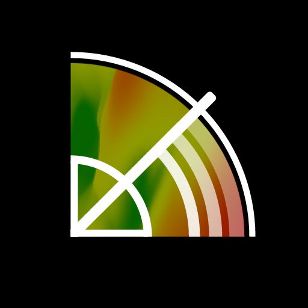
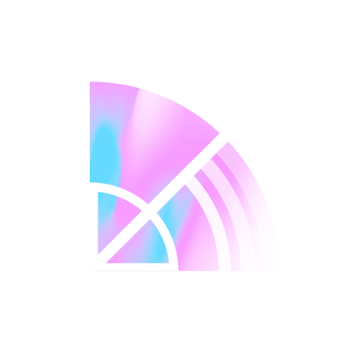

# Silver Skies

## Know before it hits.

Silver Skies is a suite of weather forecasting and radar applications, written in Rust.

| | App | What it is |
|---|---|---|
|  | [**Silver Skies**](apps/silverskies/README.md) | A simple, calm weather forecast: the forecast at a glance, plain-language summaries, fuzzy search for places and keywords, a simple radar loop, WMO alerts and optional AI summaries and answers. |
|  | [**Silver Skies Pro**](apps/pro/README.md) | The over-engineered one: a composite forecast, meteorology and radar workstation with docked panes, NEXRAD products, every alert feed, storm polygons, weather radio, TTS, multiple radar windows and a command line. |

## Building

Requires a stable Rust toolchain (1.80+).

```
cargo run --release -p silverskies        # Silver Skies
cargo run --release -p silverskies-pro    # Silver Skies Pro
```

On Linux you need the usual egui/cpal/speech-dispatcher system libraries:
`libxkbcommon-dev libwayland-dev libgtk-3-dev libasound2-dev libspeechd-dev`.

## Repository layout

```
apps/
  silverskies/  Silver Skies — the simple app (eframe)
  pro/          Silver Skies Pro — the workstation app (eframe)
crates/
  ss-core/      pure domain logic: alert taxonomy & colors, units, WMO codes, themes,
                SAME encoder/decoder, geometry, command grammar  (fully unit tested)
  ss-net/       API clients: NWS, ECCC, LibreWXR, SPC, Open-Meteo, Nominatim, OWM, NCEP, NWR
  ss-store/     JSON config/locations/session files per app, atomic writes, dedupe store
  ss-audio/     tone synthesis, native TTS, live stream player
  ss-map/       slippy-map engine for egui: tile cache, Mercator viewport, raster/WMS/polygon/
                marker/wind-barb layers
  ss-assets/    shared UI assets: bundled fonts (Google Sans family, DejaVu), Google's V1
                weather icons, SVG rasterizing, the Alt-revealed menu bar
tools/
  render-icons/ regenerates each app's PNG icons from its brand SVGs (`cargo run -p render-icons`)
```

Each app keeps its brand marks in `apps/<app>/assets/brand/` and its installer/bundle metadata
in `apps/<app>/dist/`.

## Releases

Every push to `main` builds installers of both apps for Windows (installer + portable zip),
macOS (Apple silicon and Intel `.dmg`/`.zip`) and Linux (AppImage + `.deb`) and publishes them
together as a new GitHub Release, tagged `v<workspace version>.<build number>` (for example
`v2.0.0.42`) with the commits since the previous release as its notes. Bump `version` in the
workspace `Cargo.toml` to start a new version line. Running the Release workflow by hand
builds the same installers as downloadable workflow artifacts without publishing.

## Credits

Weather icons: Google's V1 weather icon set, from
[bignutty/google-weather-icons](https://github.com/bignutty/google-weather-icons). Fonts:
Google Sans, Google Sans Flex and Google Sans Code (SIL Open Font License), DejaVu (Bitstream
Vera license).
